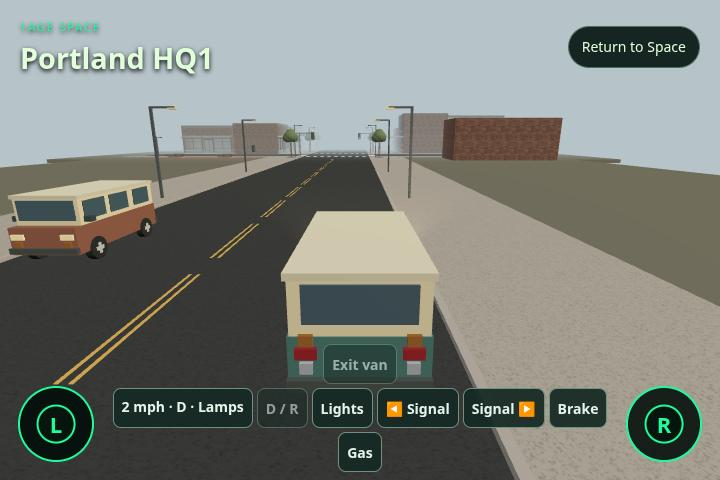
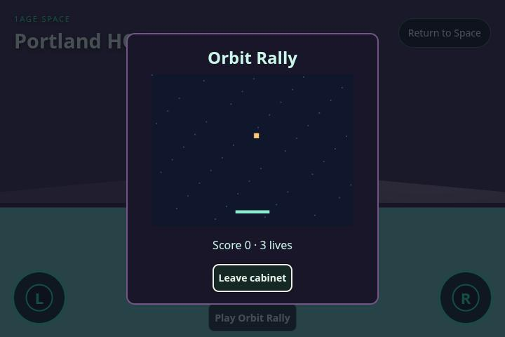

# Portland HQ1 Build 002

From the HQ1 entrance, follow MLK south for Javan Imports or north for Retro Game Bar. The review build also accepts `/hq1/?stop=javan` and `/hq1/?stop=retro`. The streets between districts use compressed distances. Both businesses have original walk-in virtual designs. Their operators list [4545 NE MLK](https://www.javan-imports.com/contact) and [6720 NE MLK](https://www.rgbpdx.com/contact-us) respectively. No partnership, licensed inventory or surveyed interior is represented.

## Van controls

Approach either two-tone van near Javan Imports. Switch vehicles by parking and walking to the other one. The other van stays where you parked it for the session.

| Action | Keyboard | Touch | Standard controller |
|---|---|---|---|
| Enter or exit a stopped van | E | Enter / Exit van | A |
| Steer | A / D or arrows | Left stick | Left stick |
| Accelerate | W or up | Gas | RT |
| Brake | S, down or Space | Brake | LT |
| Select drive or reverse while stopped | R | D / R | Y |
| Headlights | H | Lights | X |
| Left / right indicator | Q / C | Signal buttons | LB / RB |

The kinematic bicycle model uses a 2.6 m wheelbase, speed-sensitive steering, rolling resistance, service braking and separate reverse gearing. Steering and wheel spin animate. Headlights illuminate the road, brake lamps respond to the pedal, reverse lamps follow the gear and turn indicators flash. The test drive is constrained to the MLK carriageway. Signal heads face boulevard traffic at Alberta. Cross-street driving, vehicle damage, AI traffic, traction and suspension simulation are future work.

## Arcade

Walk through the central opening into Retro Game Bar, approach any of three cabinet positions and select **Play Orbit Rally**. This original paddle game supports touch drag, arrow keys, A/D and a standard controller's left stick. Score on paddle returns. Three misses end a round. Replay or leave the cabinet to walk back outside.

The URL and domain for 1AGE Autos are outside this build. Existing virtual destinations, main branch and production deployment retain their prior configuration. To remove only Build 002 after integration, revert the Build 002 commit through review.
